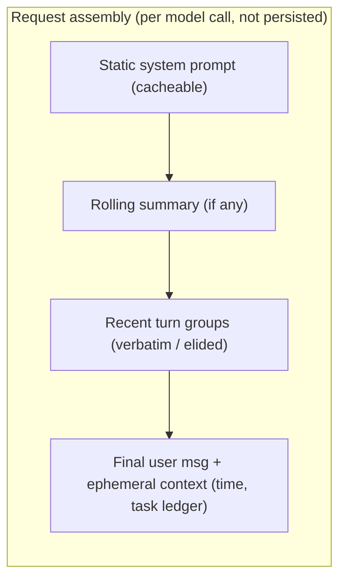
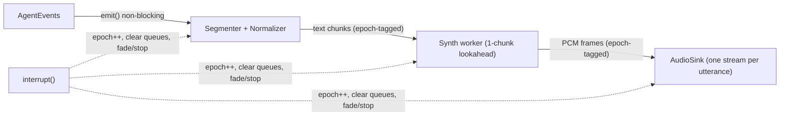
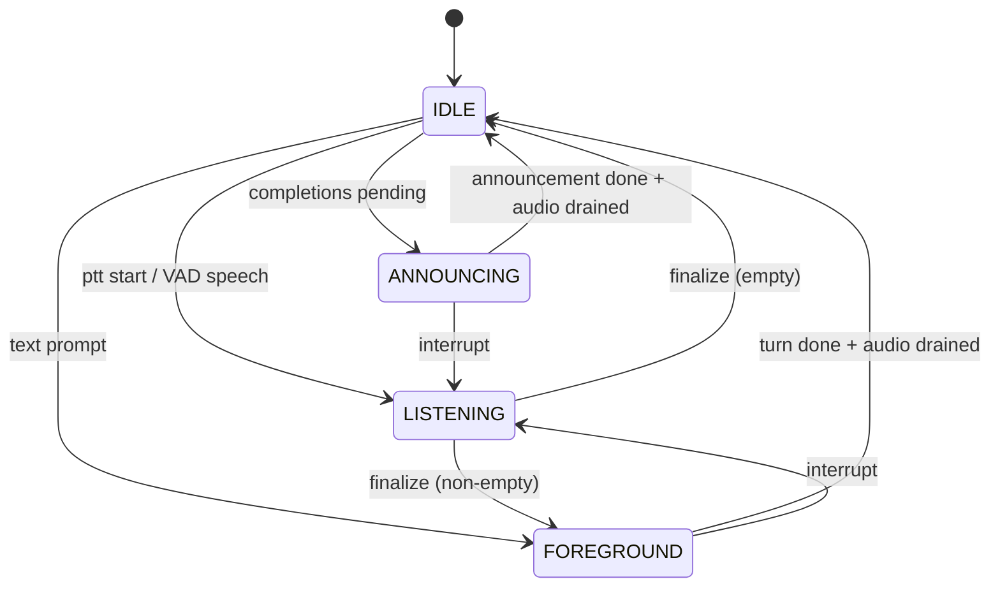
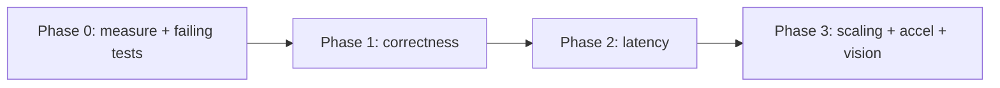

# Architecture Scaling & Runtime Hardening — Specification

**Status:** Draft for review · **Date:** 2026-10-06 · **Base commit:** `ab89441`
**Path:** Architectural (brainstorming → spec → *awaiting review* → writing-plans)

**Evidence tags** (same convention as `docs/architecture-now.md`):
**[R]** read from the cited `file:line` · **[X]** confirmed by running code · **[I]** inferred / estimated, must be measured in Phase 0.

---

## 0. Intent & Agreed Constraints

**Outcome.** Verbix should feel like one calm, fast voice that can talk while background workers do real work.
Every completed result reaches the user. Interruptions are instant and clean. Long sessions
stay fast and valid. No processes are left behind.

**Product decisions (from review, 2026-10-06):**

| # | Decision |
|---|---|
| D1 | **Local-first.** Zero-config is 100% free/offline on CPU; the only required secret is one LLM key. STT/TTS sit behind pluggable interfaces so cloud backends can be opted into later. |
| D2 | **Strict Push-to-Talk only.** No always-listening or hands-free open-mic mode. The mic is only active while the user explicitly toggles recording. Audio optimization focuses purely on zero-latency PTT release. |
| D3 | **GPU when available, CPU always works.** Target dev box is an AMD laptop with a Radeon iGPU, so **Vulkan** is the preferred acceleration path. No CUDA-only dependencies. |
| D4 | **Context compaction:** deterministic pruning on the hot path; LLM summarization only **async, off the hot path**, when idle. |

> [!NOTE]
> On D3, the research found that **ONNX Runtime has no Vulkan execution provider** (its cross-vendor GPU path is the WebGPU EP, which runs on top of Vulkan through Dawn).
> Vulkan acceleration on AMD iGPUs is mature today in **ggml / whisper.cpp** (`-DGGML_VULKAN=ON`).
> None of the leading small TTS models (PocketTTS, Kokoro, Piper) has a production Vulkan path.
> So this spec puts **STT on Vulkan (whisper.cpp)**, keeps **TTS and VAD on CPU** (both are already within budget there), and lists the ORT WebGPU EP as something to watch, not a commitment.

---

## 1. Current System Reality

Baseline: `uv run pytest -q` → **87 passed** **[X]**. Three race probes were run against the real classes
(`scratch/probe_races.py` in the session artifacts dir). Results are quoted inline as **[X]**.

> [!WARNING]
> `docs/architecture-now.md` describes an **earlier architecture** (`runtime/tasks.py`, `_maybe_announce`,
> `TaskRuntime`, bwrap-sandboxed tools, `close_aborted_turn` repair, the "announced = heard" contract).
> Those files are gone: only stale `.pyc` files remain under `runtime/__pycache__/`. Several guarantees that doc describes
> were **lost in the mini-swe-agent migration**. Many findings below are regressions, not new problems.

### 1.1 Agent engine & tool-calling loop

| Mechanism | Citation | Finding |
|---|---|---|
| Streaming turn loop | `minisweagent/agents/default.py:229-446` | One `while True` loop: stream LLM → accumulate tool calls → execute them in sequence → loop. Ends on a text-only reply, on `finish`, or on limits. **[R]** |
| Pre-tool chatter suppression | `default.py:278-298` | Text is held until **100 chars** have arrived. If a tool call arrives first, the held text is dropped (`:303`, `:320`). If >100 chars arrive *before* the tool call, that chatter has **already been spoken**. Suppressed text is still written into the assistant message's `content` (`:364`), so history keeps chatter the user never heard. **[R]** |
| Plain-answer latency tax | `default.py:294` | Every answer under 100 chars waits for stream end before any TTS starts. **[R]** |
| Tool observation size | `default.py:179-217` | Bash output goes into history **uncapped**. The head/tail truncation template in `config/worker.yaml` (`observation_template`) is only used by the sync `execute_actions` path (`:552-553`). The streaming path never reaches it. **[R]** |
| Cost limit | `default.py:248`, `:530` | `self.cost` is only incremented in sync `query()`. In `step_stream` it stays at 0, so `cost_limit: 3.0` is **never enforced** for workers. Workers have `step_limit: 0` and `wall_time_limit_seconds: 0`, so a looping worker is unbounded. **[R]** |
| Limit scope | `default.py:108-111` | `n_calls`, `cost`, and `_start_time` are per-agent-lifetime. For the long-lived **foreground** agent they accumulate across the session. If cost tracking were fixed without re-scoping, the companion would hit its limit once and fail permanently. **[R]/[I]** |
| `finish` observation | `default.py:390-395`, `runtime/tools.py:141-145` | `FinishTool.execute` returns a `ToolResult`. `str(res)` stores the dataclass repr (`ToolResult(observation=...)`) in worker history. **[R]** |
| Context growth | `default.py:147-150` | `messages` is append-only. No token counting, budget, pruning, or summary. `ContextWindowExceededError` is an abort exception (`litellm_model.py:71`). Once foreground history passes the window, **every later turn fails**, because the history persists. **[R]/[I]** |
| Turn cancellation | `runtime.py:493-509` | `cancel_turn()` cancels `_active_turn_task`. `step_stream` has **no cancellation handling**. Cancelling during a tool call leaves an assistant `tool_calls` message with no tool result. **[X]** probe: history after barge-in = `[system, user, assistant(tool_calls)]`. On OpenAI/Anthropic-style APIs the next request is rejected (unpaired `tool_call_id`). **[I]** |
| Repair logic exists, unwired | `core/history.py:43-99` | `ConversationHistory.close_aborted_turn` already implements the correct repair (synthetic tool results; replace text with what was actually delivered). Only tests use it (`tests/test_history.py:58-104`). **[R]** |
| Active-turn slot race | `runtime.py:493`, `:484` | `submit()` writes `_active_turn_task` **before** acquiring `_turn_lock`. A second concurrent submit (IPC + voice) overwrites the slot, and whichever finishes first clears it to `None`. `cancel_turn()` then misses the running turn. **[R]** |
| Side-effecting tool under cancel | `runtime/tools.py:37-43` | If a barge-in lands after `runtime.spawn()` returns but before the tool message is written, the worker runs and the foreground has no record that it started. **[I]** |
| Prompt-cache hostility | `runtime.py:456-474`, `:485` | The system prompt is rebuilt every turn with the current time to the minute. That changes the cacheable prefix every minute, which defeats provider prefix caching and raises TTFT. **[R]/[I]** |

### 1.2 STT & audio ingestion

| Mechanism | Citation | Finding |
|---|---|---|
| Capture | `voice/capture.py:38-92` | `pw-record`/`arecord` subprocess, 16 kHz s16 mono, read in 4096-byte chunks (≈128 ms) and pushed to `on_chunk`. **[R]** |
| Endpointing | `voice/pipeline.py:103-125` | Manual toggle only (Enter / IPC `toggle`). No VAD endpointing. **[R]** |
| Live STT loop | `voice/stt.py:148-173` | Every ≥0.3 s of new audio, it **re-transcribes the whole buffer from the start**. Cost is O(n²) in utterance length. **[R]** |
| Finalize | `voice/stt.py:175-247` | Waits for any in-flight full-buffer decode, runs Silero VAD on the tail, and decodes only the tail if it contains speech. The tail is cut at a byte offset, not a word boundary, so words can be split or duplicated at the seam. No `initial_prompt` continuity. **[R]/[I]** |
| VAD available | `stt.py:68`, `:213` | Silero VAD already ships with `faster_whisper.vad`. **No new dependency is needed** for streaming VAD. **[R]** |
| Provider warm-up | `pipeline.py:139-140` | Calls `runtime.provider.warm()`, which does not exist on `LitellmModel`. It is a silent no-op, so the first request pays a cold TLS handshake. **[R]** |
| Dead barge-in flag | `runtime.py:345`; `pipeline.py:118,123,146` | `user_active` is written but **never read**. The announcer can start speaking while the user is recording (and the mic picks it up). **[R]** |

**Latency waterfall today** (PTT release → first audio sample). All numbers are **[I]** estimates; Phase 0 replaces them with measurements.

| # | Stage | Citation | Est. |
|---|---|---|---|
| 1 | Terminate `pw-record`, drain reader | `capture.py:94-121` | 10–30 ms |
| 2 | Await in-flight **full-buffer** re-decode (grows with utterance length) | `stt.py:184-188` | 0–600 ms |
| 3 | Tail VAD + tail decode | `stt.py:212-246` | 20–250 ms |
| 4 | Acquire `_turn_lock` (blocked for the **whole** announcement if one is playing) | `runtime.py:484` | 0–∞ |
| 5 | Cold TLS + LLM TTFT (cache-busted prefix) | `runtime.py:485` | 350–900 ms |
| 6 | 100-char pending-text hold | `default.py:294` | 0–250 ms |
| 7 | Wait for a `". "` sentence boundary | `pipeline.py:41` | 50–200 ms |
| 8 | PocketTTS first chunk (CPU, ~200 ms vendor TTFA) | `pocket_tts.py:95-121` | ~200 ms |
| 9 | Spawn a new `pw-play` process **per sentence** | `sinks.py:102-111` | 20–60 ms |
| | **Total (idle floor)** | | **≈ 0.9 – 2.5 s** |

### 1.3 TTS & audio playback

| Mechanism | Citation | Finding |
|---|---|---|
| Sentence splitting | `pipeline.py:39-52` | Regex `(?<=[.!?])(?:\s+\|\n+)`. "Dr. Smith", "e.g. this", "v1.2. Next" split mid-phrase. No clause-level split, so a long first sentence delays first audio. No text normalization (markdown residue, paths, symbols). (The `SentenceBuffer` named in the brief does not exist; this logic lives in `SpeechTurnOutput`.) **[R]** |
| Inline playback blocks the LLM | `pipeline.py:48`; `runtime.py:495-499` | `emit()` **awaits `player.speak()`**, which plays the whole sentence before returning. The LLM stream is not consumed during playback. Synthesis and playback are strictly serial, and `_turn_lock` is held for the full audio duration. **[R]** |
| Inter-sentence gaps | `sinks.py:102` | Each `play_stream` calls `stop()` and spawns a new `pw-play`. Gap per sentence ≈ process spawn + TTS TTFA. **[R]/[I]** |
| Double-speak risk | `pipeline.py:62-65` | If the buffer is empty at `TurnComplete` (the reply ended with `"\n"`), the full `final_text` is checked against a *list of sentences* by exact match. A multi-sentence reply is never equal to any one sentence, so the whole reply is spoken again. **[R]/[I]** |
| Shared sink handle | `sinks.py:28`, `player.py:58-77` | `play_cue()` bypasses the playback lock, and `play_stream()` starts with `self.stop()`. The cue can therefore kill whatever is playing, including an announcer that is speaking. **[R]** |
| Barge-in path | `pipeline.py:115-120`, `player.py:31-36` | `player.stop()` kills `pw-play` with SIGKILL. The abrupt cut can click, and the subprocess sink gives no way to fade out. `_active_play_task` is the **caller's** task (the whole voice turn or the announcer flush), so `stop()` cancels that whole task as a side effect. **[R]** |

### 1.4 Runtime triad (Foreground → Worker → Announcer)

| Mechanism | Citation | Finding |
|---|---|---|
| Single lock for everything | `runtime.py:349`, `:484`, `:660` | One `asyncio.Lock` serializes foreground turns and announcements. It is held during TTS playback (see 1.3). **[R]** |
| Debounce cancels in-flight flush | `runtime/buffer.py:25-30` | `push()` cancels `_flush_task` even while it is **inside `on_flush`**, i.e. mid-announcement. That batch was already cleared from `_pending` (`:46-47`), so it is **lost**. **[X]** probe: two finishes 200 ms apart → flush started `[task-1]`, `[task-2]`; completed only `[task-2]`. |
| Announcer barge-in | `pipeline.py:115-117`, `runtime.py:506-509` | `cancel_turn()` does not cover the announcer (it is not `_active_turn_task`). It is only stopped indirectly, via `player.stop()` cancelling the flush task. Partial speech the user heard is **not** recorded in foreground history. **[R]** |
| Announcer context | `runtime.py:664`, `:656-659` | Starts from empty messages every time and sees only the wake prompt. It has no idea what the user asked, so it cannot say "the thing you asked about". **[R]** |
| Foreground record of announcements | `runtime.py:687-688` | Appends a bare `assistant` message (the full `final_text`, not what was heard). There is no structured task record, and it can create back-to-back assistant messages. **[R]** |
| Status pollution channel | `worker.py:181-202`, `runtime/tools.py:74-80` | `status(full=true)` puts worker command lines and 200-char bash snippets into foreground history **permanently**. **[R]** |
| Worker cancel leaves processes | `default.py:199`, `environments/local.py:56-76`, `worker.py:141-149` | Bash runs in `asyncio.to_thread`. Cancelling the asyncio task cannot stop the thread or kill the process group, so the command runs until it exits or hits the 600 s timeout. **[X]** probe: `sleep 20` still alive after cancel. |
| Process group on timeout | `local.py:68`, `:73` | `start_new_session=True` plus `killpg(SIGKILL)` on timeout is correct. But the new session also shields children from the daemon's Ctrl+C/SIGHUP, so a daemon exit orphans every in-flight command. **[R]/[I]** |
| Pipe-holding grandchildren | `local.py:71` | `communicate()` waits for EOF. A command that backgrounds a daemon holding stdout (`server &`) blocks the worker for the full 600 s timeout. Then `killpg` kills the daemon it meant to start. **[I]** |
| Secrets in worker env | `local.py:28` | `os.environ \| config.env`: the worker shell inherits every provider API key. **[R]** |
| IPC calls missing methods | `ipc/server.py:270`, `:281` | `runtime.get_task_status_summary` and `runtime.cancel_task` do not exist, so the IPC `status`/`cancel` actions raise `AttributeError`. **[R]** |
| Wake output fan-out | `pipeline.py:97-98`, `server.py:97-98` | In `--serve --voice`, the pipeline takes `wake_output`, so IPC clients never see announcements. **[R]** |
| Dead event bus | `runtime.py:442` | `_broadcast_event` is never called. The IPC forwarder (`server.py:150-167`) listens to a channel nothing writes to. **[R]** |
| Dead CLI surface | `cli.py:112-121`; `tools/sandbox.py` | `--isolate-worktrees` and `--allow-network` are parsed and never used. The bwrap sandbox is not connected to anything. **[R]** |

---

## 2. Architectural Principles & Invariants

These are **testable rules**. Each one gets at least one regression test in the phase that introduces it.

### 2.1 Turn & history invariants (both agents)
- **H1 Valid on every request.** Before *every* model call, a validator checks that each assistant `tool_calls` id has exactly one following `tool` message, that no `tool` message is orphaned, and that roles are valid. If the check fails, it repairs the history (close-aborted-turn semantics), logs at `ERROR`, and still sends a valid request.
- **H2 History equals what happened, and what was heard.** A foreground `assistant` message's text is the text **delivered** to the user (sentence granularity: a chunk counts as heard once its playback has started). Suppressed pre-tool chatter is not stored.
- **H3 Side effects are recorded.** If a side-effecting foreground tool (`spawn`, `cancel`) started, its result **is written to history** even if the turn is cancelled (the tool is shielded from cancellation).
- **H4 Foreground hygiene.** Foreground history may contain only: user utterances, delivered assistant text, foreground tool calls with their (capped) results, and the compaction summary. Worker prompts, worker transcripts, raw bash output, the announcer wake prompt, and ephemeral grounding **never** persist there.
- **H5 Pairing-safe pruning.** Compaction removes or rewrites only whole **turn groups** (foreground) or whole **steps** (workers). It never separates a `tool_calls` message from its results.

### 2.2 Floor (who may speak or think) invariants
- **F1 One floor owner.** At most one of `{LISTENING, FOREGROUND, ANNOUNCING}` is active. The floor arbiter owns this state; no ad-hoc flags such as `user_active`.
- **F2 Never over the user.** Nothing starts producing audio while the floor is `LISTENING`.
- **F3 Interrupt is synchronous and idempotent.** `interrupt()` silences audio before it returns (no awaits on the silencing path), then cancels the owning task, then repairs history.
- **F4 No lost completions.** Every worker reaching `completed` or `failed` ends up as exactly one of `heard`, `interrupted`, or `superseded` (user already got it through `status`) in the Task Ledger. Nothing is dropped silently. New arrivals never cancel an in-flight announcement.

### 2.3 Isolation invariants
- **P1 No orphans.** After cancel, timeout, or runtime shutdown, no process from an in-flight worker command is still running (checked with `pgrep` on a tagged marker in tests).
- **P2 Bounded output.** Captured command output is capped in memory (head+tail) and in context (observation cap).
- **P3 Bounded work.** Every worker has an effective step limit, wall-clock limit, and cost limit. Foreground limits are **per turn**.

### 2.4 Latency invariants
- **L1 Nothing on the hot path blocks on audio.** LLM stream consumption never awaits playback.
- **L2 Finalize is O(open segment).** STT finalize cost does not grow with total utterance length.
- **L3 Stable prefix.** Static system prompt bytes do not change between turns. Volatile grounding (time, task ledger) is injected at request time, after the cacheable prefix.

---

## 3. Layer-by-Layer Decision Specifications

### 3.1 Agent & Context Layer

**A1 — Cancellation-safe `step_stream`.**
Wrap the loop body so that `CancelledError`, and any exception after the assistant message has been recorded, runs `_close_aborted_turn(delivered_text)` before re-raising. The repair is ported from `core/history.py:43-99` to dict messages. Synthetic tool results read `"cancelled: interrupted by user before completion"`. Delivered text is supplied by the output sink through a `delivered_text()` callable on the `TurnHandle` (A3).

**A2 — Shielded side-effecting tools.**
Registry entries take a `side_effecting: bool` flag. Those handlers run under `asyncio.shield`, and their tool message is appended in a `finally`. `spawn` and `cancel` are side-effecting; `status` is not.

**A3 — `TurnHandle` replaces `_active_turn_task`.**
It is created **after** the floor is acquired and holds `task`, `kind` (`foreground|announcer`), and `delivered_text()`. `cancel()` is idempotent. This fixes the slot-overwrite race.

**A4 — Pre-tool chatter policy.**
Replace the 100-char threshold with a **first-speakable-chunk** boundary (§3.3 segmenter rule S1). Text is held only until the first chunk boundary; if a tool call has not appeared by then, the text is released. Text suppressed because a tool call arrived is **not** stored in `assistant.content` (H2).

**A5 — Observation cap in the streaming path.**
Add a deterministic `cap_observation(text, max_chars=10_000)` (5k head + 5k tail + elision marker), applied in `_execute_tool`. Foreground tool results get a smaller cap (default 1 500 chars). The unused `observation_template` stays sync-only.

**A6 — Scoped limits + real cost tracking.**
- Request `stream_options={"include_usage": True}` and accumulate `usage` into `cost` via `litellm.completion_cost` (`ignore_errors` mode).
- Foreground: `step_limit` and `cost_limit` reset **per turn** (default 8 model calls per turn, $0.25 per turn).
- Workers: defaults `step_limit: 60`, `wall_time_limit_seconds: 1800`, `cost_limit: 1.0` (configurable in `worker.yaml`).

**A7 — Context budget & compaction (two tiers).**

- **Budget.** `budget = min(config.max_context_tokens, 0.6 × litellm.get_model_info(model).max_input_tokens)`. Foreground default `max_context_tokens = 16_000`: a voice companion does not need a huge window, and a smaller prompt means lower TTFT and cost. Worker default is 60% of the model window. Tokens are counted with `litellm.token_counter`, falling back to `chars / 4`.
- **Units.** Foreground *turn group* = one `user` message plus every following non-`user` message up to the next `user`. Announcement messages form their own group. Worker *step* = one `assistant(tool_calls)` plus its `tool` results. The worker's system message and first user (task) message are pinned.
- **Tier 1: deterministic, synchronous, on the hot path (O(n), no model call).**
  1. Groups older than the last 3: replace `tool` message contents with a stub (`"[status output elided]"`, keeping `tool_call_id`). Truncate tool-call arguments over 500 chars.
  2. Worker steps older than the last 8: replace the observation with its first 200 chars + `"[elided N chars]"`.
  3. If still over budget, drop the oldest groups/steps (never pinned ones) and append them to a `pending_fold` list.
- **Tier 2: async LLM summary, off the hot path (D4).** When `pending_fold` passes 2 000 tokens **and** the floor is `IDLE`, a background task asks the cheapest configured model to merge `pending_fold` into a rolling summary of at most 400 tokens. The summary covers user facts and preferences, open threads, and task ids with outcomes. The summary is swapped in **only while the floor is IDLE** (atomic under the floor). If summarization fails, the dropped groups are simply gone, because Tier 1 already guaranteed the budget. The summary is never on the latency path.
- **Volatile grounding (L3).** Static identity, tools, and environment stay in the system message. Current time and the **Task Ledger** (§3.4) are prepended to the final `user` message **at request time only**. They are never stored (H4).

**A8 — History validator** (H1) is a pure function in `minisweagent/utils/history.py`, run in `LitellmModel.query_stream` and `ProviderStreamAdapter.query_stream`. It also merges adjacent assistant text-only messages at request time, for providers that require strict role alternation.

### 3.2 STT & Audio Ingestion Layer

**S-Interface.** The new interface is `StreamingSTT.open_session(sample_rate) -> STTSession`, where `STTSession` exposes `feed(pcm)`, `async finalize() -> str`, `cancel()`, and optional `on_partial(text)` / `on_endpoint()` callbacks. The existing `transcribe()` stays for one-shot use. The Phase 2/3 backends are:

| Backend | Accel | Default? | Notes |
|---|---|---|---|
| `faster-whisper` (CTranslate2) | CPU (CUDA-only GPU) | **Yes (zero-config)** | Current engine; `tiny.en` int8. |
| `whisper.cpp` (ggml) | **Vulkan** iGPU / CPU | Auto when a Vulkan device is detected | Allows `base.en`/`small.en` within budget on the iGPU. Needs a Vulkan-built lib, so it is **optional** and auto-probed, never required. |
| Cloud streaming (Deepgram / Gladia class) | Remote | Opt-in via config + key | Uses the provider's native endpointing and partials. |

`stt.backend: auto | faster-whisper | whisper-cpp | <cloud>`. `auto` tries whisper.cpp+Vulkan and falls back to faster-whisper on CPU.

**S1 — Segment-committed incremental decoding.** This replaces the O(n²) loop in `stt.py:148-173`.
1. Run Silero VAD (`faster_whisper.vad`, CPU, 32 ms frames) on capture chunks as they arrive.
2. An internal pause of ≥ 250 ms **commits** the segment `[seg_start, pause]`: decode it **once** and append the result to `committed_text`. Committed audio is never decoded again.
3. Segments are force-committed at 12 s, at the lowest-energy frame in the last 1 s, which bounds the worst case.
4. Each decode passes the last ~200 chars of `committed_text` as `initial_prompt` for continuity.
5. `finalize()` decodes only the open segment (usually < 3 s), which satisfies L2.
6. Partials for the open segment are off by default on CPU and enabled automatically on GPU backends.

**S2 — Strict Push-to-Talk (D2).** `voice.mode: ptt`. No background listening loop or always-open mic. Recording is triggered strictly via user interaction (toggle key, Enter, or IPC `toggle`). When recording ends, the microphone stream is immediately closed and resources released. Audio pipeline optimizations apply exclusively to incremental transcription during active key-down and instant earcon/finalization on key-release.

**S3 — Real provider warm-up.** `LitellmModel.warm()` pre-opens the HTTPS connection when recording starts, via a cheap authenticated request (e.g. a 1-token completion with `max_tokens=1`, or a models list where the provider supports it). It is rate-limited to once per 60 s.

**S4 — Capture hygiene.** Clear `capture.on_chunk` when a session ends. Read 20 ms frames (640 bytes) instead of 4096 so VAD resolution is not limited by read granularity.

### 3.3 TTS & Audio Playback Layer

**T-Pipeline.** `SpeechOutput` replaces `SpeechTurnOutput` with three decoupled stages and bounded queues. `emit()` only **enqueues** (L1).

**Segmenter rules** (a pure, table-tested function):
- **S1 eager first chunk.** Emit at the first clause boundary (`,` `;` `:` `—`) once ≥ 40 chars, or at a sentence end, whichever comes first.
- **S2.** Later chunks break at sentence boundaries, with a soft max of 220 chars and a forced split at the last clause boundary.
- **S3 no split inside protected tokens:** abbreviation list (`Mr. Mrs. Dr. St. vs. etc. e.g. i.e. U.S.` …), decimals and versions (`3.14`, `v1.2.3`), ellipses, URLs and paths (any token without whitespace), and line-initial ordinals (`1.`).
- **S4.** On `TurnComplete`, flush the remainder. **Never** re-speak `final_text` when deltas were already delivered (fixes the double-speak risk).

**Normalizer** (TTS input only; never applied to history or display): strip markdown residue (`* _ # \``, leading bullets), replace URLs with "a link", reduce long paths to their final component, map symbols (`%`→"percent", `&`→"and", `→`→"to"). Numbers are passed through unless Phase 0 listening tests show PocketTTS mispronounces them.

**Sinks.**
- `SubprocessAudioSink` (current) becomes **one long-lived `pw-play` per utterance**: opened on the first frame and closed at drain or interrupt. That removes the per-sentence spawn gap.
- New `CallbackAudioSink` (`sounddevice` / PortAudio over pipewire-alsa, **optional dependency**). A ring buffer feeds the audio callback. `interrupt()` sets a flag; the callback applies a **10 ms linear fade-out**, then outputs silence, which avoids clicks. Silence arrives within one callback period (≤ 20 ms). The sink reports an exact played-sample cursor, which is used for "delivered" accounting.
- Selection: `audio.sink: auto | callback | subprocess`. `auto` uses `callback` when `sounddevice` imports, otherwise `subprocess`.
- The earcon goes through the same sink as an epoch-tagged frame. It no longer calls `stop()`, which fixes the shared-handle race.

**Barge-in sequence** (F3). The whole path is sync; no awaits until step 5.
1. `epoch += 1`; stale chunks and frames are discarded by an epoch check at every stage.
2. Clear the text and PCM queues.
3. `sink.interrupt()`: callback → fade flag; subprocess → `kill()` on the process (accepting a possible click).
4. Set the TTS `stop_event` so the synth thread exits at the next chunk (`pocket_tts.py:93-123` already supports this).
5. Cancel the owning `TurnHandle` and repair history with `delivered_text()` (§3.1 A1).

**Deadlock rules.** No lock is held across an await that `interrupt()` needs. The TTS thread talks to the loop only through `call_soon_threadsafe`, guarded by `loop.is_closed()`. The playback lock is removed; the queues serialize playback.

**Engine comparison & decision.**

| Engine | Where | Streaming | TTFA (desktop) | RAM | Accel path | Verdict |
|---|---|---|---|---|---|---|
| **PocketTTS** (Kyutai, 100M) | Local | Yes (autoregressive) | ~200 ms CPU (vendor) | High (torch) | CPU only | **Keep as default.** Meets the TTFA budget. |
| Kokoro-82M | Local (ONNX) | Per chunk | Proportional to chunk length; fast CPU RTF | Medium | ORT WebGPU EP (future) | Candidate if PocketTTS quality or RAM is unacceptable. |
| Piper | Local (ONNX) | Per sentence | Lowest CPU | Very low | CPU | Low-end fallback candidate. |
| Cartesia / Deepgram Aura / ElevenLabs Flash | Cloud | WebSocket text-in streaming | Model ~40–100 ms (vendor) + network RTT | ~0 | n/a | Opt-in backends behind `TextToSpeech`; never the default (D1). |

Decision: **no engine change in this spec.** Only the `TextToSpeech` interface is formalized, with `synthesize(text, stop_event)`. Alternatives are evaluated in Phase 3 **only if** Phase 0/2 measurements miss the TTS budget.

### 3.4 Runtime Triad Loop

**R1 — Floor arbiter** replaces `_turn_lock`, `user_active`, and `is_idle`.

- Foreground requests from multiple sources (voice, IPC, REPL) queue FIFO for the floor.
- The floor is released only after audio **drains** (the sink reports idle), not when the LLM stream ends. That keeps announcements from following an answer that is still playing.

**R2 — Task Ledger** is the single source of truth for task state. Each entry holds `id, objective, status, started_at, finished_at, result_summary, progress[-3:], delivery ∈ {pending, heard, interrupted, superseded}`. `status` and `cancel` tools and the IPC API read from the ledger. The **compact ledger** (at most 6 entries, ≤ 600 chars) is injected into the foreground's ephemeral context (A7). It replaces raw-transcript `status(full=true)` as the normal path. `full=true` stays available, but its result is capped (A5) and elided after the turn (Tier 1).

**R3 — Completion queue + announcer loop** replaces `CompletionBuffer`.
- `WorkerTask` completion → `ledger.mark_finished()` → `queue.put(id)`. Cancelled tasks are not queued (current behavior, `runtime.py:569-572`).
- **One** long-lived `AnnouncerLoop` task:
  1. Wait until the queue is non-empty and the floor is `IDLE`.
  2. Collect for `batch_window` (300 ms).
  3. Drain everything queued (cap 3 items; overflow → "…and N more finished; ask me for details").
  4. Take the floor (`ANNOUNCING`) and run the announcer.
- Items that arrive during an announcement **wait for the next batch**. In-flight announcements are never cancelled by new arrivals (F4).
- **Announcer context:** the announcer system prompt, plus the last 2 foreground turn groups (delivered text only, no tool messages), plus each item's objective and `result_summary`. That lets it phrase "the tests you asked me to run…". The announcer stays tool-less and starts fresh per batch.
- **After a heard announcement:** append one `assistant` message with the **delivered** text to foreground history (H2), and set ledger `delivery=heard`.

**R4 — Edge-case semantics.**

| Case | Behavior |
|---|---|
| E1. User starts speaking while a worker finishes | Floor is `LISTENING`, so the completion queues. The announcer waits for `IDLE` after the user's turn and audio drain. If the foreground calls `status(task_id)` for that task during the turn, it is marked `superseded` and **not** announced again. |
| E2. Multiple workers finish simultaneously | Batched by the window. Later arrivals form the next batch. Order is finish time. None are cancelled or lost (the probe becomes a regression test). |
| E3. User interrupts the announcer | `interrupt()` → audio silenced; announcer task cancelled. Heard prefix appended to foreground history. Items marked `interrupted`. They are **not** auto-replayed, but they stay visible in the ledger so the foreground can reference them. |
| E4. User interrupts a foreground turn mid-tool | A1 repairs the history. A2 guarantees a `spawn` already in progress is recorded. |
| E5. IPC prompt during a voice turn | Queues FIFO for the floor. The IPC client receives events once its turn runs. |
| E6. Worker finishes while the user cancels it | `cancel` reports "already completed" from the ledger. The completion is announced normally. |
| E7. Runtime shutdown / daemon exit | `runtime.aclose()`: floor interrupt → cancel all workers (P1 kill path) → stop sinks/capture → close IPC. Also registered for SIGINT/SIGTERM. |

**R5 — Worker process isolation** (`LocalEnvironment`).
- `execute` becomes **async**: `asyncio.create_subprocess_shell(..., start_new_session=True)`. The environment tracks the pgids of in-flight commands.
- **On cancel or timeout:** `killpg(SIGTERM)`, wait 2 s, then `killpg(SIGKILL)`, and reap.
- **Output:** read the stream incrementally into a head/tail buffer capped at 1 MB (P2). After the shell exits, drain for at most 200 ms and then stop reading. That fixes the pipe-holding-grandchild hang. Intentionally backgrounded daemons **survive normal completion**, by design (the user may ask for "start the dev server").
- **On runtime shutdown:** kill every tracked in-flight pgid.
- **Medium-term (Phase 3):** optional `systemd-run --user --scope` per worker task, so a cgroup kill guarantees no orphans even if the daemon crashes. Linux-only and auto-detected.
- **Env:** remove Verbix's own provider credential variables (`VERBIX_API_KEY`, and the active LiteLLM provider key) from the worker env by default. `worker.yaml: environment.inherit_secrets: false|true`. *(Open question Q3.)*

**R6 — Wiring fixes.** Implement `Runtime.status`/`cancel` as the IPC methods (remove the calls to missing methods). Give `wake_output` a `FanOut` that sends to speech **and** to IPC broadcast. Have the ledger and floor emit on `_broadcast_event` (§3.5). Fix the `finish` observation repr. Remove the dead `--isolate-worktrees`/`--allow-network` flags, or wire them (Q4).

### 3.5 Extensibility & Future Multi-Modal Vision

- **Typed runtime event bus.** Bring the dead `_broadcast_event` to life with typed events: `FloorChanged`, `TaskStarted`, `TaskProgress` (tool name + short arg preview), `TaskFinished`, `TranscriptPartial`, `TranscriptFinal`, `LatencyMark`. IPC forwards them (existing `server.py:150-167`). A future tray overlay or HUD subscribes without touching the runtime.
- **Streaming status.** Workers push `TaskProgress` into the ledger, so `status` answers instantly without parsing transcripts. Optional (off by default): a one-line spoken progress note for tasks over 120 s, only when the floor is `IDLE`, at most once per task.
- **Screen inspection (vision).** A worker-only `screenshot` tool (`grim` on Wayland, falling back to the `xdg-desktop-portal` screenshot API) returns an image path. Images enter **worker** context as multimodal content parts through the existing `expand_multimodal_content` (`minisweagent/models/utils/openai_multimodal.py`). The eviction policy keeps only the latest image in context; older images become their text caption. Images never enter foreground history (H4). A fast "glance" path for the foreground is deferred until latency is measured.
- **Plug points.** `StreamingSTT`, `TextToSpeech`, `AudioSink`, VAD, and the worker `ToolRegistry`. Every backend is selected by config with `auto` detection. No backend import happens unless it is selected.

---

## 4. Prioritized Phasing & Migration Path

Each phase ends with a green suite and is independently shippable. Every phase includes the existing 87 tests plus that phase's new invariant tests.

### Phase 0 — Instrumentation & regression harness (prerequisite)
1. `LatencyMark` timestamps (monotonic) at: `ptt_release | vad_endpoint`, `stt_final`, `llm_request`, `llm_first_token`, `first_speakable_chunk`, `tts_first_pcm`, `sink_first_write`, `interrupt_called`, `audio_silent`. `VERBIX_TRACE=1` writes them as JSONL.
2. Turn the three **[X]** probes into failing regression tests (buffer loss, orphan tool call, orphan process).
3. A history-validator test helper that asserts H1 after every scripted turn in the existing e2e tests.

### Phase 1 — Immediate hardening (correctness; no new dependencies)
1. A1–A3: cancellation-safe `step_stream`, shielded side-effecting tools, `TurnHandle`, delivered-text recording.
2. R1–R3: floor arbiter, Task Ledger, completion queue + announcer loop (replaces `CompletionBuffer`, `_turn_lock`, `user_active`).
3. R5: async `LocalEnvironment` with killpg on cancel/timeout, shutdown cleanup, output caps.
4. A5, A6, A8: observation caps, scoped limits + stream cost tracking, request-time validator.
5. A7 **Tier 1** only (deterministic budget + elision), plus request-time volatile grounding (L3).
6. R6: IPC method fixes, wake-output fan-out, `finish` repr, CLI flag cleanup.
7. Rewrite `docs/architecture-now.md` to match the code after this phase.

### Phase 2 — Voice latency (restructure; optional `sounddevice` only)
1. `SpeechOutput` pipeline: segmenter, normalizer, synth lookahead, one sink stream per utterance, non-blocking `emit()`.
2. S1 segment-committed incremental STT (reuses the bundled Silero VAD).
3. S3 real warm-up; A4 first-chunk chatter policy.
4. `CallbackAudioSink` with fade-out barge-in (optional extra `audio`), subprocess fallback.
5. Measure against §5. Only if TTS misses budget, open the engine evaluation in Phase 3.

### Phase 3 — Medium-term scaling
1. A7 **Tier 2** async summarization.
2. `whisper.cpp` Vulkan STT backend with `auto` detection.
3. Opt-in cloud STT/TTS backends behind the interfaces.
4. Event-bus consumers: ledger progress events, worker `screenshot` tool, `systemd-run` scope isolation.

---

## 5. Success Metrics & Latency Budgets

**Reference rig:** the AMD Radeon iGPU laptop; CPU-only path unless stated; flash-class cloud LLM (`gemini-3.5-flash-lite` default).
**V2V** = PTT release (or VAD endpoint) → first audio sample written to the sink. Measured by `LatencyMark`, over ≥ 50 scripted utterances of 2–8 s.

### 5.1 Voice-to-Voice budget

| Stage | p50 target | p95 target | Today (est. **[I]**) |
|---|---|---|---|
| STT finalize (CPU `tiny.en`) | ≤ 150 ms | ≤ 250 ms | 30–850 ms |
| STT finalize (Vulkan `base.en`) | ≤ 120 ms | ≤ 200 ms | n/a |
| Request assembly + validator + Tier 1 | ≤ 10 ms | ≤ 25 ms | ~0 (no pruning) |
| LLM TTFT (provider; warm, cached prefix) | ≤ 400 ms | ≤ 700 ms | 350–900 ms |
| First token → first speakable chunk | ≤ 120 ms | ≤ 250 ms | 50–450 ms |
| TTS first PCM (PocketTTS CPU) | ≤ 200 ms | ≤ 300 ms | ~200 ms |
| Sink start | ≤ 20 ms (callback) / 50 ms (subprocess) | ≤ 60 ms | 20–60 ms per sentence |
| **V2V total** | **≤ 900 ms** | **≤ 1 400 ms** | **≈ 0.9–2.5 s** |
| Inter-chunk audio gap | ≤ 30 ms | ≤ 80 ms | TTFA + spawn per sentence |

LLM TTFT is provider-bound and reported separately. The **Verbix-owned** share of V2V (all stages except TTFT) must be ≤ 500 ms p50 / ≤ 800 ms p95.

### 5.2 Interruption & floor

| Metric | Target |
|---|---|
| `interrupt_called` → `audio_silent` | ≤ 30 ms (callback) / ≤ 60 ms (subprocess) |
| `interrupt_called` → floor `LISTENING`, history repaired | ≤ 100 ms |
| Announcer audio while floor is `LISTENING` | **0 occurrences** |
| Audible click on barge-in (callback sink) | None in listening test (10 ms fade) |

### 5.3 Reliability (each is an automated test)

| Metric | Target |
|---|---|
| Requests sent with invalid history (H1) | 0. Validator repairs are logged; any repair in the test suite is a failure. |
| Lost completions (F4) under the burst test (10 workers finishing within 500 ms, with random barge-ins) | 0. Every task ends `heard`, `interrupted`, or `superseded`. |
| Orphaned processes after cancel / timeout / shutdown (P1) | 0 (`pgrep` marker check) |
| Foreground context after 200 scripted turns with `status(full=true)` noise | ≤ budget (16k tokens); no `ContextWindowExceededError` |
| Runaway worker | Stopped by step, wall-clock, or cost limit; ledger shows `failed: LimitsExceeded` |

### 5.4 Resources

| Metric | Target |
|---|---|
| Steady RSS, voice mode, models loaded, CPU path | ≤ 1.5 GB (measure in Phase 0; PocketTTS + torch dominate) |
| RSS growth over a 2 h soak (200 turns, 20 workers) | ≤ 50 MB |
| Idle CPU (voice mode, not recording) | ≤ 2% of one core |
| CPU while recording (S1, partials off) | ≤ 1 core average |
| Per-command captured output memory | ≤ 1 MB (P2) |

---

## 6. Testing Strategy

- **Unit (pure):** segmenter/normalizer table tests; history validator/repair; Tier 1 pruning keeps pairs together (property-style: random histories → pruned output always valid); ledger state transitions.
- **Concurrency (fake model, fake sink, real runtime):** E1–E7 as scripted scenarios with deterministic `asyncio` timing; the burst test; barge-in at every event index of a scripted turn (H1 must hold after each).
- **Process:** cancel / timeout / shutdown kill tests using a tagged `exec -a <marker> sleep`; the grandchild-holds-pipe test completes in under 1 s.
- **Latency:** the Phase 0 trace harness is run manually on the reference rig (not in CI). The CI asserts only Verbix-owned stage budgets, with fake STT/TTS/LLM timings.

---

## 7. Open Questions (need your call; defaults shown)

| # | Question | Default in this spec |
|---|---|---|
| Q1 | Should an announcement **interrupted** by the user be replayed automatically later? | **No.** Kept in the ledger as `interrupted`; the foreground can mention it. |
| Q2 | If a task finishes during the user's turn, should the foreground **weave it in** ("…oh, and your build finished") instead of a separate announcement after? | **No.** Separate announcement after the turn, unless the foreground called `status` on it (`superseded`). |
| Q3 | Strip provider API keys from the worker shell environment by default? | **Yes**, with `inherit_secrets: true` opt-out. |
| Q4 | `--isolate-worktrees` / `--allow-network` and `tools/sandbox.py` (bwrap): wire up, or delete? | **Delete the flags in Phase 1**; sandboxing gets its own spec later. |
| Q5 | Add `sounddevice` as an optional `audio` extra for the click-free callback sink? | **Yes, optional**; subprocess sink remains the zero-dependency fallback. |
| Q6 | Foreground context budget of 16k tokens. Too small for your usage? | 16k |

---

## 8. Out of Scope

- Changing the default LLM, or adding local LLM inference.
- Worker sandboxing (bwrap / worktrees). Q4 covers only cleanup of the dead surface.
- Persisting sessions or the ledger across daemon restarts.
- GUI / overlay implementation (only the event bus it would consume).
